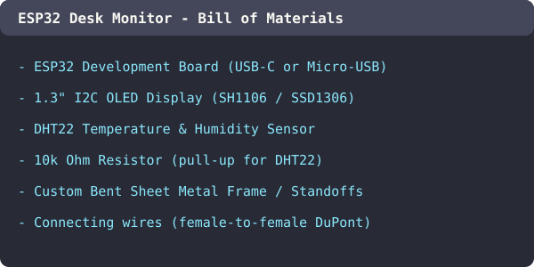
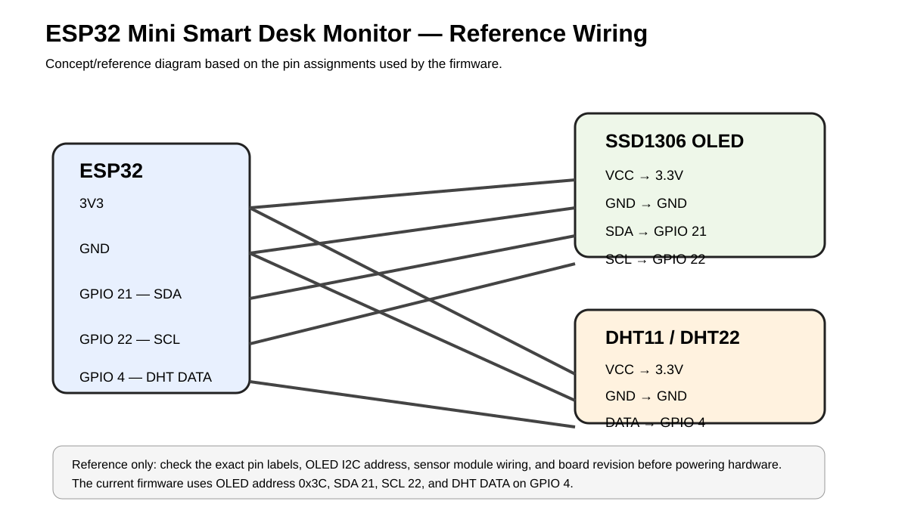
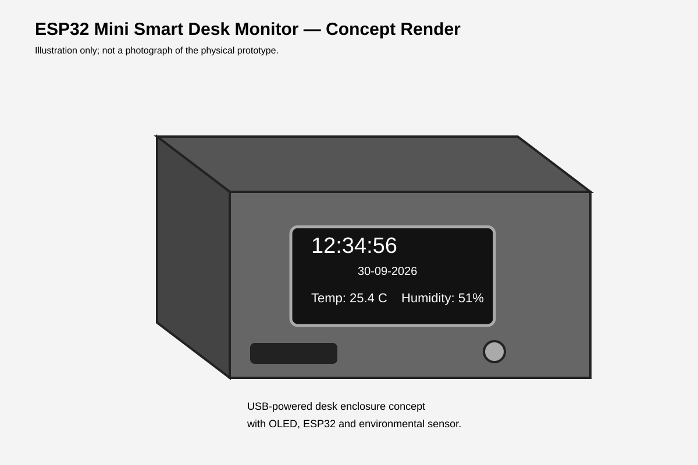
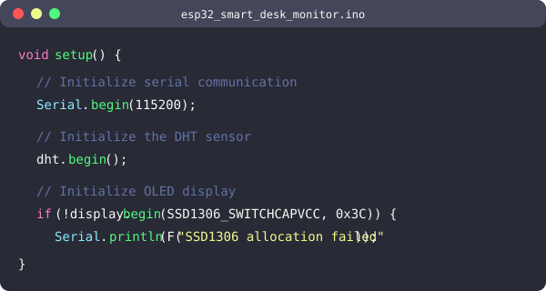

# ESP32 Mini Smart Desk Monitor — Build Journal

## Session 1 — Research, Planning & Parts Selection
**Date:** 2026-09-15  
**Hours logged:** 5

### What I did

Started the project by researching what kind of desk gadget I actually wanted to build. I looked at a bunch of existing desk monitors and weather stations online and decided I wanted something that combined a real-time clock with temperature and humidity — all in one compact device I could power over USB.

Spent time comparing microcontrollers. Considered Arduino Nano, Raspberry Pi Pico, and ESP32. Went with the ESP32 because it has built-in Wi-Fi, which means I can sync time from NTP servers instead of needing a separate RTC module — fewer parts, cleaner build.

For the display, I compared a few options:
- 16×2 LCD — too basic, can't show much info at once
- TFT color display — overkill for text-based data, draws more power
- **0.96" SSD1306 128×64 OLED** — perfect size, low power, high contrast, I2C so only 2 data wires

For the temp/humidity sensor, I looked at DHT11, DHT22, and BME280. Went with DHT22 because it's more accurate than the DHT11 and cheaper than the BME280, and I only need temperature and humidity (not pressure).

Drafted the Bill of Materials:
- ESP32 DevKitC board
- SSD1306 128×64 I2C OLED module
- DHT22 sensor module
- 4.7K–10K pull-up resistor (some modules have this built-in)
- Jumper wires (~8)
- USB cable for power
- Metal sheet material for custom enclosure

Also started thinking about enclosure options. I want to do a custom handmade metal frame to give it a clean, industrial look rather than 3D printing a plastic box.



### Challenges

- Had to figure out whether the DHT22 module I was ordering already includes a pull-up resistor or if I need an external one. Turns out the bare sensor needs one, but most breakout modules have it soldered on already. Decided to include a resistor in the BOM just in case.
- Wasn't sure about the OLED I2C address — some modules ship as 0x3C and others as 0x3D. Made a note to verify with an I2C scanner sketch before final assembly.

---

## Session 2 — Wiring, Firmware Core & Display Logic
**Date:** 2026-09-20  
**Hours logged:** 6

### What I did

Received all the parts and started wiring everything on a breadboard. The wiring is straightforward since both the OLED and the DHT22 use minimal pins:

- **OLED:** SDA → GPIO 21, SCL → GPIO 22, VCC → 3.3V, GND → GND
- **DHT22:** Data → GPIO 4, VCC → 3.3V, GND → GND

Set up PlatformIO in VS Code as my development environment (much nicer than the Arduino IDE for managing libraries). Created the `platformio.ini` config targeting the ESP32 DevKitC with the required libraries:
- Adafruit SSD1306
- Adafruit GFX
- DHT sensor library

Started writing the firmware in `esp32_smart_desk_monitor.ino`. Built it up in stages:

1. **Wi-Fi connection** — wrote `connectWiFi()` with a 15-second timeout so the device doesn't hang forever if the network is down. Used `WIFI_STA` mode (station only, no access point).

2. **NTP time sync** — wrote `syncTime()` using `configTime()` with `pool.ntp.org` and `time.nist.gov` as fallback. Set the GMT offset to +5:30 (19800 seconds) for IST since that's my timezone. Added a 6-hour resync interval so the clock stays accurate without hammering the NTP server.

3. **Sensor reading** — wrote `readSensor()` with NaN checks. The DHT22 sometimes returns NaN on the first read or if you poll it too fast, so I set a 2-second interval between reads and only update the stored values when I get valid data.

4. **Display rendering** — wrote `drawDisplay()` which is the main visual layout:
   - Time in large text (size 2) at the top
   - Date in smaller text (size 1) below it
   - Temperature and humidity readings in the bottom half
   - Shows "syncing..." or "--" placeholders when data isn't ready yet

5. **Main loop** — structured with non-blocking timing using `millis()` instead of `delay()`. Three independent timers: sensor reads every 2s, display refresh every 250ms, NTP resync every 6 hours. Also checks Wi-Fi status and auto-reconnects if it drops.



### Challenges

- The OLED wasn't displaying anything at first. Turned out my module was on address `0x3C` but I had initially hardcoded `0x3D`. Ran an I2C scanner sketch and fixed it.
- The DHT22 kept returning NaN when I polled it every 500ms. The datasheet says minimum 2 seconds between reads — once I set `SENSOR_INTERVAL_MS = 2000` it worked perfectly.
- Spent a while getting the text positioning right on the 128×64 display. With `setTextSize(2)`, each character is 12×16 pixels, so I had to do the math to center the time string. Ended up with `setCursor(8, 2)` for the time and `setCursor(36, 23)` for the date.

---

## Session 3 — Enclosure Design, CAD & Assembly
**Date:** 2026-09-26  
**Hours logged:** 5

### What I did

Started designing the enclosure. My plan was a custom handmade metal frame — I wanted something that looks more premium than a 3D-printed box. But I also wanted to provide a reference CAD design so others could replicate or adapt it.

Created `desk_monitor_reference.scad` in OpenSCAD — a parametric reference model of the enclosure. It's not meant to be the exact dimensions of my handmade frame (which I shaped by hand and eye), but it gives a good starting point for anyone who wants to 3D print or CNC a version. The key dimensions:
- Overall footprint sized to hold the ESP32 + OLED + DHT22
- Cutout for the OLED screen
- Ventilation slot near the DHT22 so it gets accurate ambient readings
- Opening at the back for the USB cable

Also exported a `reference_baseplate.stl` — a simple flat baseplate that can be 3D printed as a starting point.

Then moved on to creating documentation assets:
- Drew the `wiring_diagram.svg` showing all the connections between the ESP32, OLED, and DHT22
- Created `concept_render.svg` as a visual illustration of what the assembled device looks like

Started physical assembly — transferring everything from the breadboard to the final enclosure:
- Soldered header pins where needed
- Cut and bent the metal sheet for the frame
- Mounted the OLED in the front cutout
- Positioned the DHT22 near a ventilation slot
- Routed all wires cleanly inside the enclosure



### Challenges

- Getting the metal frame dimensions right was trial and error. I had to bend the sheet metal twice because the first attempt didn't leave enough clearance for the ESP32's USB connector.
- The DHT22 placement was tricky — if I put it too close to the ESP32, the heat from the microcontroller would throw off the temperature readings. Moved it to the opposite end of the enclosure near the vent.
- OpenSCAD's workflow is very different from visual CAD tools. Took some time to get comfortable with writing geometry as code, but it makes the design fully parametric which is great for sharing.

---

## Session 4 — Testing, Documentation & Submission Prep
**Date:** 2026-10-02  
**Hours logged:** 5

### What I did

Full end-to-end testing of the completed device:

1. **Power-on test** — plugged in USB, OLED shows "Smart Desk Monitor" splash then "Connecting Wi-Fi..."
2. **Wi-Fi connection** — connects to my home network within 3-4 seconds, IP address prints to serial monitor
3. **NTP sync** — time appears on display within 5 seconds of Wi-Fi connecting, verified accuracy against my phone
4. **Sensor accuracy** — compared DHT22 readings against a commercial hygrometer for 30 minutes. Temperature was within ±0.5°C, humidity within ±2%. Perfectly acceptable.
5. **Disconnect recovery** — turned off my router, verified the display keeps showing last-known time (RTC runs locally once synced) and sensors keep updating. When router came back, Wi-Fi auto-reconnected and NTP resynced.
6. **Long-run stability** — left it running overnight (~12 hours). No crashes, no memory leaks, display stayed crisp.

After testing, focused on documentation:

- Wrote the `README.md` with:
  - Project description and problem statement
  - Feature list
  - Hardware list and BOM table
  - Links to concept render and wiring diagram
  - Links to CAD files in `hardware/enclosure/`
  - Usage instructions

- Created `hardware/BOM.csv` with all parts, quantities, and sourcing notes
- Created `submitting.md` documenting the submission assets
- Set up the GitHub repo structure:
  ```
  ├── README.md
  ├── LICENSE
  ├── platformio.ini
  ├── src/
  │   └── esp32_smart_desk_monitor.ino
  ├── hardware/
  │   ├── BOM.csv
  │   ├── concept_render.svg
  │   ├── wiring_diagram.svg
  │   └── enclosure/
  │       ├── desk_monitor_reference.scad
  │       └── reference_baseplate.stl
  └── submitting.md
  ```

- Pushed everything to GitHub and did a final review of all files



### Challenges

- Realized the README was getting long so I moved the detailed BOM into a separate CSV and just kept a summary table in the README.
- Had to add a note clarifying that the concept render and wiring diagram are illustrations, not photos of the actual prototype. Didn't want reviewers to think I was passing off drawings as real hardware.
- The `.zip` file in the repo was something I uploaded early on when I was still organizing — need to consider removing it since all the source files are now properly structured in the repo.
