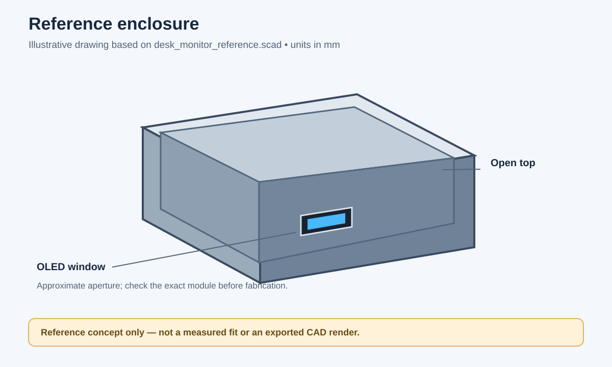
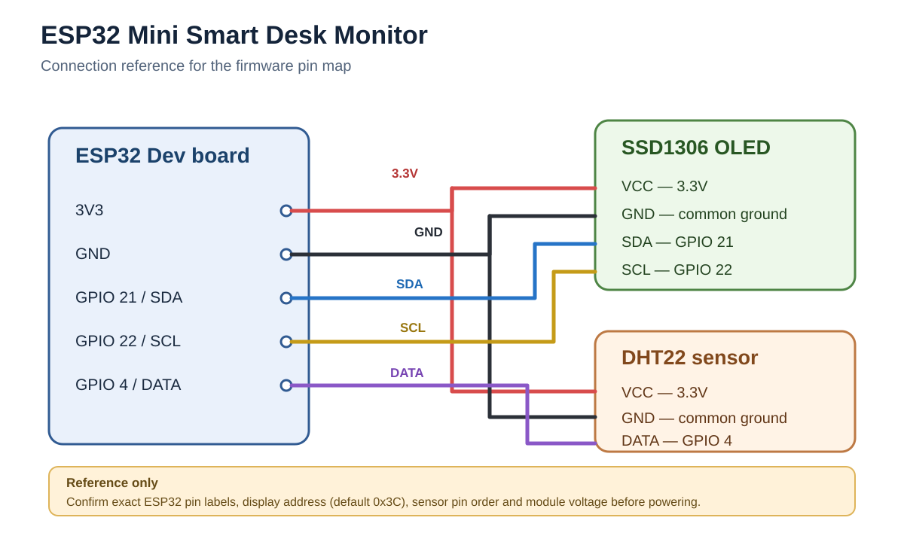

# ESP32 Mini Smart Desk Monitor

Firmware and reference hardware documentation for an ESP32-based desk display intended to show network-synchronized time and temperature/humidity readings on a 128×64 I²C OLED.

## Current status

This repository contains firmware source, a PlatformIO configuration, a wiring schematic, and a generic OpenSCAD enclosure model. **A successful hardware test is not documented here.** The repository does not include a build log, serial capture, sensor comparison record, or reproducible test evidence.

The firmware assumes an SSD1306 128×64 I²C display and a DHT22 sensor connected as shown below. Verify the actual parts and pin labels before wiring or powering anything.

## Visual references



*Illustrative view of the generic OpenSCAD enclosure; it has not been measured against a physical unit.*



**Build photo:** No verified build photo is included. The only supplied video frame inspected during review shows a portrait-oriented display, while the firmware in this repository draws a landscape 128×64 layout. It was left out rather than presented as proof of this firmware running.

## Features intended by the firmware

- Request network time using SNTP over Wi-Fi.
- Display time and date on an SSD1306 128×64 I²C OLED.
- Read temperature and relative humidity from a DHT22.
- Retain the last valid sensor values when a read fails.
- Continue displaying the system clock after a successful sync, including during a later network interruption.

The ESP32 is not paired with a separate external RTC in this design. Timekeeping and sensor behaviour still need to be verified on the target hardware.

## Hardware and pin map

| Module | Pin | ESP32 connection |
|---|---|---|
| SSD1306 OLED | VCC | 3.3 V |
| SSD1306 OLED | GND | GND |
| SSD1306 OLED | SDA | GPIO 21 |
| SSD1306 OLED | SCL | GPIO 22 |
| DHT22 | VCC | 3.3 V |
| DHT22 | GND | GND |
| DHT22 | DATA | GPIO 4 |

Use a common ground. DHT breakout boards often include a DATA pull-up resistor; a bare sensor may require one. Module pin order and voltage tolerance vary, so confirm your component's datasheet rather than relying on wire colours.

## Bill of materials

The table below describes the intended configuration, not proof that each part was purchased or used. See [hardware/BOM.csv](hardware/BOM.csv) for notes and reference documentation.

| Part | Qty. | Notes |
|---|---:|---|
| ESP32 Arduino-compatible development board | 1 | Exact board model is not recorded |
| SSD1306 128×64 I²C OLED module | 1 | Confirm address and module dimensions |
| DHT22 temperature/humidity sensor | 1 | Firmware defaults to DHT22 |
| Pull-up resistor | 1 optional | Only if required by the bare sensor/module |
| Jumper wires | 1 set | For prototype wiring |
| USB cable | 1 | Connector depends on the board |
| Enclosure material | As needed | Model is generic and unvalidated against parts |

## Build and upload

### PlatformIO

1. Install VS Code and the PlatformIO extension.
2. Open this repository as a PlatformIO project.
3. In [src/esp32_smart_desk_monitor.ino](src/esp32_smart_desk_monitor.ino), set `WIFI_SSID` and `WIFI_PASSWORD` locally. Do not commit real credentials.
4. Confirm the board, display address and sensor type match your hardware.
5. Build the project, connect the ESP32, upload, and inspect the serial monitor at 115200 baud.

A GitHub Actions workflow is configured to run a PlatformIO build on pushes and pull requests. A green workflow only verifies compilation; it does not verify that the physical hardware works.

### Libraries

The PlatformIO configuration declares:

- Adafruit SSD1306
- Adafruit GFX Library
- DHT sensor library
- Adafruit Unified Sensor

## Reference enclosure

- [OpenSCAD source](hardware/enclosure/desk_monitor_reference.scad)
- [SVG reference illustration](hardware/enclosure/model_preview.svg)

The enclosure is a generic starting point, not a measured replica of a physical device or a confirmed fit for any specific board. Before fabrication, check display aperture, board clearance, sensor airflow, connector access, screw features and wall thickness against the exact parts.

To export an STL locally with OpenSCAD:

```sh
openscad -o desk_monitor_reference.stl hardware/enclosure/desk_monitor_reference.scad
```

No fabrication-ready PCB is included: there is no routed board layout, KiCad project, Gerber set or drill file. The wiring schematic is a connection reference, not a PCB design.

## Configuration

The source defaults are:

- OLED address: `0x3C`
- I²C SDA: GPIO 21
- I²C SCL: GPIO 22
- DHT DATA: GPIO 4
- DHT type: `DHT22`
- Fixed time offset: UTC+05:30

If your sensor is a DHT11, change `#define DHTTYPE DHT22` to `#define DHTTYPE DHT11`. Confirm the display I²C address with an I²C scanner if the display does not initialize.

## Validation checklist

Before describing this as a completed build, record evidence for:

- [ ] Firmware compiles for the exact ESP32 board.
- [ ] OLED initializes at the selected I²C address and orientation.
- [ ] SNTP obtains a valid time.
- [ ] DHT sensor readings update at an appropriate interval.
- [ ] Wi-Fi loss/reconnection behaviour is observed.
- [ ] Enclosure openings and clearances fit the actual components.
- [ ] A real photo of the hardware running this exact firmware is added, if available.

## Provenance and licence

The repository does not yet record the upstream source of the project idea or document whether any elements were adapted from another design. Review [ATTRIBUTION.md](ATTRIBUTION.md) and record the source, author and licence for any reused work before claiming originality or redistributing it. The included MIT licence should not be assumed to override third-party terms.

## Repository layout

```text
.
├── .github/workflows/platformio.yml
├── .gitignore
├── ATTRIBUTION.md
├── JOURNAL.md
├── LICENSE
├── README.md
├── submitting.md
├── platformio.ini
├── src/
│   └── esp32_smart_desk_monitor.ino
└── hardware/
    ├── BOM.csv
    ├── schematic.svg
    └── enclosure/
        ├── desk_monitor_reference.scad
        └── model_preview.svg
```
