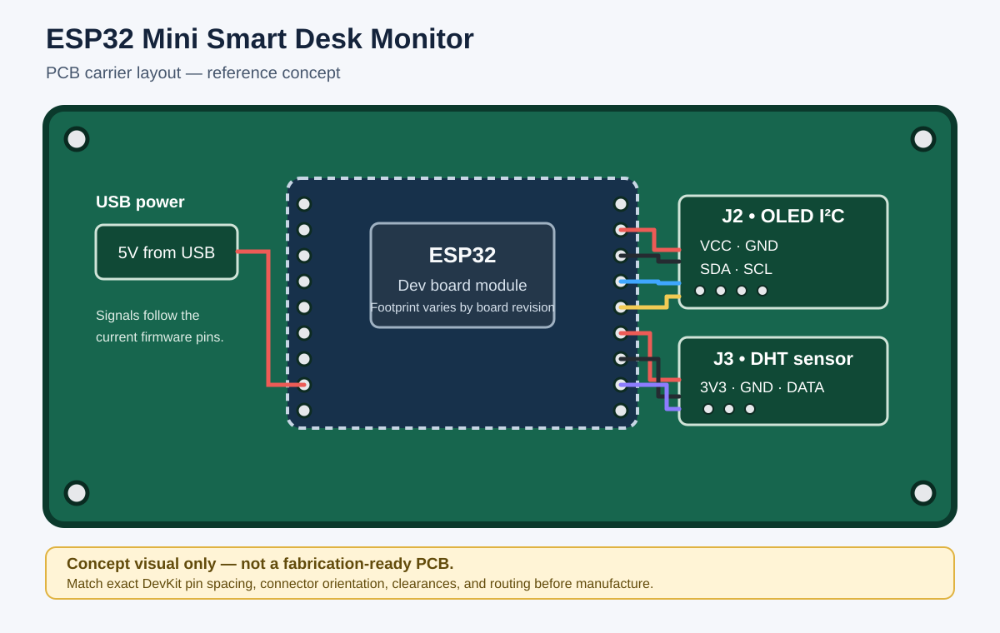
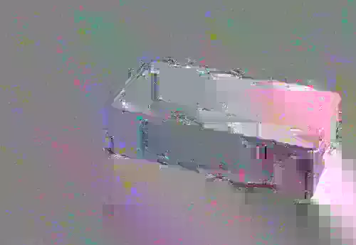

# ESP32 Mini Smart Desk Monitor

A compact ESP32 desk display that combines a Wi-Fi-synchronized clock with live temperature and humidity readings on an OLED screen.

## Hardware visuals

| **Powered-on build photo** | **PCB layout (reference concept)** |
|---|---|
|  |  |
| Actual prototype photo from the attached project video. | Concept-only layout; it is **not a fabrication-ready PCB** and is not claimed to be installed in the photographed build. |
| **Wiring schematic** | **3D enclosure model (reference)** |
|  |  |
| Pin assignments match the firmware below. See also the [wiring diagram](hardware/wiring_diagram.svg). | Preview rendered from the editable OpenSCAD file; dimensions are generic and were not measured from the handmade metal frame. |

## Problem solved

A normal desk clock only shows the time, while checking temperature and humidity usually requires a separate thermometer/hygrometer or opening an app. This project combines those everyday readings into one small, USB-powered device that can sit on a desk, workstation, gaming setup, or dashboard.

## Features

- Wi-Fi-synchronized clock using NTP
- Live temperature monitoring
- Live humidity monitoring
- 128×64 I2C OLED display
- USB powered
- Custom handmade metal frame
- Simple firmware that can be expanded with more sensors and features

## Hardware

- ESP32 development board
- 0.96-inch SSD1306 128×64 I2C OLED
- DHT11 or DHT22 temperature/humidity sensor
- Jumper wires
- USB cable/power source
- Custom metal frame/enclosure

## Bill of Materials

The complete BOM is available in [`hardware/BOM.csv`](hardware/BOM.csv).

| Part | Qty | Notes |
|---|---:|---|
| ESP32 development board | 1 | ESP32 DevKitC-style reference |
| SSD1306 128×64 I2C OLED | 1 | Verify module address before assembly |
| DHT22 temperature/humidity sensor | 1 | DHT11 is supported by changing one firmware setting |
| 4.7K–10K resistor | 1 | Needed for a bare DHT22; many modules already include a pull-up |
| Jumper wires | ~8 | Prototype wiring |
| USB cable | 1 | Connector depends on ESP32 board revision |
| Metal enclosure material | 1 set | Handmade/custom; measure your actual prototype |

## Hardware design files

- [`pcb_layout.svg`](hardware/pcb_layout.svg) — PCB carrier-layout concept; not fabrication-ready.
- [`schematic.svg`](hardware/schematic.svg) — wiring schematic showing the firmware pin assignments.
- [`wiring_diagram.svg`](hardware/wiring_diagram.svg) — existing editable/vector wiring diagram.
- [`concept_render.svg`](hardware/concept_render.svg) — concept illustration, not a physical prototype photo.
- [`desk_monitor_reference.scad`](hardware/enclosure/desk_monitor_reference.scad) — editable OpenSCAD enclosure reference.
- [`model_preview.webp`](hardware/enclosure/model_preview.webp) — preview rendered from the OpenSCAD file.
- [`reference_baseplate.stl`](hardware/enclosure/reference_baseplate.stl) — simple printable reference baseplate.
- [`build_photo.webp`](hardware/build_photo.webp) — powered-on build photo extracted from the attached project video.

The OpenSCAD/STL enclosure is a generic reference model. The handmade metal frame in the build photo was not measured to produce this model. The PCB image is a visual layout concept only; there is no claim that this PCB was manufactured or used in the photographed prototype.

## Wiring

### OLED (SSD1306 I2C)

| OLED | ESP32 |
|---|---|
| VCC | 3.3V |
| GND | GND |
| SDA | GPIO 21 |
| SCL | GPIO 22 |

### DHT sensor

| DHT | ESP32 |
|---|---|
| VCC | 3.3V |
| GND | GND |
| DATA | GPIO 4 |

Many DHT sensor modules already include the required pull-up resistor. For a bare sensor, use the resistor recommended by its datasheet.

## Software setup

### Arduino IDE

Install the ESP32 board package and these libraries:

- Adafruit SSD1306
- Adafruit GFX Library
- DHT sensor library by Adafruit
- Adafruit Unified Sensor

Open `src/esp32_smart_desk_monitor.ino`, enter your Wi-Fi credentials, select your ESP32 board, and upload.

### PlatformIO

This repository includes `platformio.ini`. Open the project in PlatformIO and build/upload normally.

## Configuration

At the top of the sketch:

```cpp
const char* WIFI_SSID = "YOUR_WIFI_NAME";
const char* WIFI_PASSWORD = "YOUR_WIFI_PASSWORD";
```

Default settings:

- OLED address: `0x3C`
- I2C SDA: GPIO 21
- I2C SCL: GPIO 22
- DHT data: GPIO 4
- DHT type: DHT22
- Time zone: Asia/Kolkata (UTC+5:30)

For a DHT11, change:

```cpp
#define DHTTYPE DHT22
```

to:

```cpp
#define DHTTYPE DHT11
```

## How it works

1. The ESP32 connects to Wi-Fi.
2. It synchronizes local time from an NTP server.
3. The DHT sensor provides temperature and humidity readings.
4. The ESP32 refreshes the OLED with the current time, date, temperature, and humidity.
5. If a sensor read fails, the last valid reading is retained.

## Reference component documentation

- [Espressif ESP32-DevKitC documentation](https://docs.espressif.com/projects/esp-dev-kits/en/latest/esp32/esp32-devkitc/)
- [Adafruit DHT22](https://www.adafruit.com/product/385)
- [Adafruit SSD1306 OLED wiring guide](https://learn.adafruit.com/monochrome-oled-breakouts/wiring-128x64-oleds)

## Project structure

```text
.
├── README.md
├── LICENSE
├── platformio.ini
├── src/
│   └── esp32_smart_desk_monitor.ino
├── hardware/
│   ├── BOM.csv
│   ├── build_photo.webp
│   ├── pcb_layout.svg
│   ├── schematic.svg
│   ├── wiring_diagram.svg
│   ├── concept_render.svg
│   └── enclosure/
│       ├── desk_monitor_reference.scad
│       ├── model_preview.webp
│       └── reference_baseplate.stl
└── esp32-mini-smart-desk-monitor.zip
```

## Future ideas

- Weather information
- Air-quality sensor
- Automatic display brightness
- Alarm/timer
- Minimum/maximum temperature history
- CO₂ monitoring
- Room-status icons
- Improved enclosure

## Status

The powered-on prototype is shown in the build photo. The enclosure and additional features are still being improved. The PCB layout and enclosure render in this repository are explicitly reference concepts, not verified fabrication files.

## License

MIT License. See [LICENSE](LICENSE).
